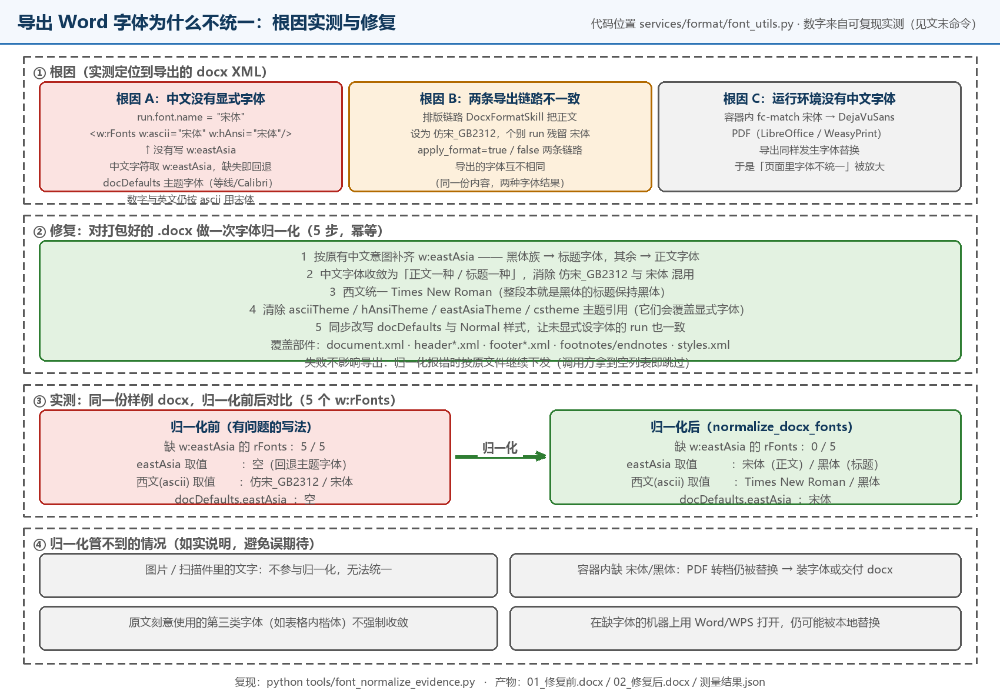

# ZhiBiao（智标）— 全流程智能招投标平台

<div align="center">


**AI 智能招投标助手 · 标书生成 · 投标生成 · 投标检查 · 文档排版 全流程自动化**

[功能特性](#功能特性) • [界面预览](#界面预览) • [技术架构](#技术架构) • [快速开始](#快速开始) • [项目结构](#项目结构) • [开源许可](#-开源许可) • [联系方式](#-联系方式)

[](LICENSE)
[](https://github.com/Foulereee)
[](mailto:1817558146@qq.com)

</div>

> 🚀 **全流程智能招投标 Agent**：4 阶段流水线（**招标解读 / 投标生成 / 投标检查 / 文档排版**），多 Agent 协同 + 可编排工作流，**21 项专业合规检查规则**、**多 LLM 供应商灵活切换**（DeepSeek / 硅基流动 / OpenAI / 通义等），轻量级 Skill 引擎 + 可插拔能力，RAG 知识库（支持**语义重排**与公司画像过滤），MinerU 扫描件 OCR 抽取，商机监控 + 今日热点聚合，桌面客户端 / 服务端 / Docker 一键部署。
>
> 💡 **部署形态**：默认 **纯 B/S（浏览器访问）** —— 服务端 nginx 站点 + API，用户端只需浏览器，无需安装任何客户端。

> 本项目基于 [guangshu100/BidMaster-Pro](https://github.com/guangshu100/BidMaster-Pro)（AGPL-3.0）二次开发，感谢原作者；修改说明见 [NOTICE.md](NOTICE.md)。
>
> **运行形态：纯 B/S（浏览器访问）** —— 用户侧无需安装任何客户端。

---

## 🆕 本仓库重点改进（相对上游）

> 不是简单拷贝：运行形态统一为**纯 B/S（浏览器访问）**，并修复了导出、鉴权、字体、任务链路等影响实际可用性的问题。
> 相对上游的完整差异见 [CHANGELOG.md](CHANGELOG.md)，来源与署名见 [NOTICE.md](NOTICE.md)。

### 🔧 重点修复

| 问题 | 本仓库的修复 |
| --- | --- |
| **导出 Word 时 Markdown 标记直接出现在正文** | 修正 Markdown → Word 渲染路径，标题 / 粗体 / 列表 / 表格按 Word 样式输出 |
| **导出件封面、页脚缺失或页码错乱** | 补齐封面页与页脚页码，导出前重建分节属性，成果可直接交付 |
| **导出 Word 字体不统一（同一行中文与数字两种字体）** | 定位到根因：`run.font.name` 只写 `w:ascii/w:hAnsi`、**不写 `w:eastAsia`**，中文字符于是回退 `docDefaults` 主题字体，而数字/英文仍按 ascii 用宋体。新增 `services/format/font_utils.py` 对打包好的 docx 做 5 步归一化（见下方实测） |
| **排版链路的字体与未排版链路不一致（仿宋_GB2312 / 宋体混用）** | 按段落样式识别标题（Heading1~3 一律黑体），把误套上来的正文字体纠正掉，使 `apply_format=true/false` 两条导出链路字体一致 |
| **新主机按示例部署后随机退出登录 / 401** | 登录会话保存在进程内字典，而示例配置给的是 `--workers 2`：多进程间会话不共享。已把 `docker/.env.docker.example` 固定为 `UVICORN_WORKERS=1` 并写明原因（生产实际也是 1） |
| **Windows 下 `start-postgres.bat` / `stop-postgres.bat` 无法执行** | 这两个批处理原本是 LF 行尾，cmd 会逐行报"不是内部或外部命令"。已在 `.gitattributes` 固定 `*.bat text eol=crlf` |
| **`alembic upgrade head` 在全新克隆上必然失败** | 仓库内确实没有 `db/migrations`（`alembic.ini` 指向它）。文档改为 `psql -f db/init_pg.sql`，并说明启动时 `init_db()` 会 `create_all` 补齐其余表（实测 22 张） |
| **资讯中心抓取接口 500** | `services/news/fetchers.py` 直接 import 的 `feedparser` 没写进 `pyproject.toml`，已补齐（并补 `redis` / `minio` 等隐式依赖） |
| **部分接口缺少鉴权，存在越权风险** | 为相关路由补齐认证依赖与 RBAC 校验，未登录不可访问（实测无 token 全部 401） |
| **LLM 参数被中间层吞掉、报错不可见** | 网关改为 `openai.AsyncOpenAI` 直连兼容端点（不经 litellm 转发），超时与重试可控 |
| **“执行检查中”长时间无响应** | 修正检查类 Skill 的超时与并发行为（`_check_timeout` / `_run_skill_limited`），长任务进度实时回传 |
| **Agent 工具注册与上下文绑定异常** | 修复 `core/agent_framework/` 的工具注册、上下文绑定与数据库查询工具 |
| **改配置把 `.env` 注释全冲掉** | 新增 `core/env_store.py`：无损改写 `.env`（保留注释、分组与顺序），写前备份 |
| **容器启动不稳定** | 修正 `Dockerfile.api`、`docker-compose.yml`、`entrypoint.sh`、`nginx.conf` |

### ✨ 新增能力

| 新功能 | 说明 |
| --- | --- |
| **投标检查 · AI 修复方案** | `POST /api/check/{project_id}/fix-plan` 逐项给出「改哪里、怎么改」，`GET …/fix-plan` 回读；方案与检查报告绑定留档 |
| **投标检查 · 问题原文定位** | `GET …/fix-locate`、`…/fix-locate-all` 用 bigram + 段落切分把每个问题定位到项目章节的具体片段，返回可核对的原文摘录 |
| **投标检查 · 一键应用修复** | `POST …/fix-apply` 把选中的修复写回章节正文，改前留底、可回溯 |
| **投标检查 · 报告留存与导出** | 检查报告可导出 Word（`_build_check_report_docx`）、可导出 Markdown / PDF / HTML（`check_report_export_skill`），也可删除（`DELETE …/reports/{report_id}`） |
| **投标检查 · 上传标书直接查** | 除「从项目生成」外新增「上传已有标书直接检查」，检查链路统一超时与并发上限（`_check_timeout` / `_run_skill_limited`），长任务不再假死 |
| **投标生成 · 按大纲顺序生成** | `order_chapters_by_outline` / `_outline_node_order` 按大纲层级排序；`resolve_chapter_words` 解析章节字数；`build_chapter_system_prompt` 组装系统提示词；`_strip_duplicate_heading` 清理重复标题；并发生成有上限（`_gen_limited`） |
| **文档输出 · 目录与多格式** | 一键插入目录并可**选目录级别**（`toc` / `toc_levels`）；docx 为唯一中间格式，doc / PDF 由 LibreOffice 实时转换，PDF 另有 WeasyPrint 兜底；三种格式导出后都过一遍字体归一化 |
| **文档输出 · 导出前体检查验** | 未生成正文的章节自动跳过并明确提示，避免导出半成品；所有章节为空时直接拦下并引导去「投标生成」 |
| **纯 B/S 部署形态** | 前端构建产物由 nginx 托管、`/api` 反代到后端；浏览器打开即用，用户侧零安装（见上方架构图与下方链路图） |
| **窄屏 / 移动端适配** | 新增 `renderer/src/hooks/useIsNarrow.ts`，重做 AppLayout / Header / Sidebar 的三段式布局，手机浏览器可直接使用 |
| **品牌与参数在线配置** | `GET/PUT /api/app-config`：平台名称、Logo、端口等写入 `.env` 即时生效，无需手改文件（写入走 `core/env_store.py`，不破坏注释） |
| **时间与页码工具** | 新增 `utils/datetime.ts`（统一时区与展示格式）与 `utils/wordPage.ts`（Word 页码 / 分节处理） |
| **一键迁移工具链** | `deploy/`：`export_all.sh` / `import_all.sh` / `rebuild_and_verify.sh` / `seed_admin.py`，换主机时数据、上传件与站点配置一起搬（`seed_admin.py` 实测幂等建 27 权限 / 4 角色 / 管理员） |
| **部署手册与迁移方案** | `deploy/` 内附带《全新主机部署手册》《部署迁移方案》，新机器照抄即可 |
| **可复现的实测脚本** | `tools/font_normalize_evidence.py`：把字体归一化的前后差异量化，下表数据就是它跑出来的 |
| **开源合规文件** | `NOTICE.md` / `CHANGELOG.md` / `CONTRIBUTING.md` / `SECURITY.md` / `THIRD_PARTY_NOTICES.md` |

### 🧪 修复效果实测（可复现）

字体不统一是导出环节最典型的问题。下表**不是示意图，是跑代码量出来的**：



| 观测项（`word/document.xml`，5 个 `w:rFonts`） | 修复前 | 修复后 |
| --- | --- | --- |
| 缺 `w:eastAsia` 的 `w:rFonts` | **5 / 5**（中文全部回退主题字体） | **0 / 5** |
| 中文字体取值集合 | 空（由 Word 主题字体临时决定） | 宋体（正文）/ 黑体（标题） |
| 西文字体取值集合 | 仿宋_GB2312 / 宋体（两条链路混用） | Times New Roman / 黑体 |
| `docDefaults` 里的 `eastAsia` | 空 | 宋体 |
| 主题引用（`asciiTheme` 等会覆盖显式字体的属性） | 存在 | 已清除 |

复现方式（依赖见「快速开始」，输出去系统临时目录，也可自己指定）：

```bash
python tools/font_normalize_evidence.py            # 打印上表 + 结论
python tools/font_normalize_evidence.py ./out       # 连同样例 docx 一起落到 ./out
```

> **为什么"修复后"偶发看着仍不统一？** 归一化只收敛成「正文一种 / 标题一种」，下面几类它管不到，属于已知边界：
> 1. 图片、扫描件、截图里的文字不参与归一化；
> 2. 容器内若没装中文字体，PDF 转档（LibreOffice / WeasyPrint）仍会被替换成 DejaVu —— 需要在镜像里装字体，或者直接交付 docx；
> 3. 原文刻意使用的第三类字体（例如表格里的楷体）不会被强制收敛；
> 4. 在缺少该字体的机器上用 Word / WPS 打开，本地仍可能替换字体。

---

## 📋 项目简介

智标 是基于 AI Agent 架构的全流程智能招投标平台。通过 LLM（大语言模型）、RAG（检索增强生成）和 Skill Engine（技能引擎）三大核心引擎，实现从**招标文件解读**、**投标书自动生成**、**合规性检查**到**文档排版输出**的完整工作流自动化。

- **智能标书生成**: 自动理解招标文件，一键生成高质量投标书
- **投标流程自动化**: 大纲生成、内容填充、格式排版一键完成
- **21 项合规检查**: 保证金 / 签字盖章 / 有效期 / 一致性 / 重复率 / 价格合理性等全方位审核
- **多 LLM 灵活切换**: DeepSeek / 硅基流动 / OpenAI / 通义千问 / Ollama 本地模型，可热切换
- **RAG 知识库**: 企业资料 / 历史标书向量化存储 + 语义重排 + 公司画像过滤
- **商机监控**: 招投标公告自动抓取 + 今日热点聚合 + 关键词精准匹配

---

## 📸 界面预览

> 以下 13 张截图全部取自本仓库实际运行的系统，均为**浏览器端（B/S）**界面。
> （登录页截图已移除：画面内包含默认管理员账号提示，不适合放在公开仓库。）

| 页面 | 截图 | 页面 | 截图 |
| :---: | :---: | :---: | :---: |
| **工作台** |  | **招标解读** |  |
| **投标生成 - 结构模板** |  | **投标生成 - 大纲编辑** |  |
| **投标生成 - 正文生成** |  | **投标检查** |  |
| **文档输出** |  | **资讯中心** |  |
| **平台设置 - 智能体模型** |  | **平台设置 - LLM 供应商** |  |
| **平台设置 - MinerU OCR** |  | **平台设置 - 权限管理** |  |
| **平台设置 - Skill 管理** |  |  |  |

---

## ✨ 功能特性

### 🎯 核心工作流

#### 1. 招标解读 (Interpret)
- **智能文档解析**: 支持 PDF/DOCX/TXT 等多格式招标文件解析
- **关键信息提取**: 自动识别评分标准、资质要求、技术参数等核心要素
- **风险预警**: 多维度风险评估，标记潜在废标风险点
- **评分矩阵**: 自动生成评分细则对照表

#### 2. 投标生成 (Generate)
- **大纲生成**: 基于招标文件智能生成投标文件大纲
- **内容创作**: AI 辅助撰写各章节内容，支持扩写和优化
- **知识检索**: RAG 引擎提供企业知识库和历史案例参考
- **AI 配图**: 智能生成配套图表和示意图

#### 3. 投标检查 (Check)
- **合规性检查**: 检查是否符合招标文件强制性要求
- **资格审查**: 验证企业资质、业绩、人员等资格条件
- **一致性校验**: 确保前后文数据、金额、日期等信息一致
- **重复率检测**: 避免内容过度重复或抄袭
- **价格合理性**: 分析报价逻辑和竞争性
- **21 项专业检查**: 涵盖保证金、签字盖章、有效期等全方位审核

#### 4. 文档输出 (Format)
- **智能排版**: 自动调整格式、字体、段落样式
- **模板配置**: 支持自定义投标文件模板
- **多格式导出**: docx (源) / doc / PDF 三种格式一键导出，docx 为唯一中间格式
- **格式检查 / 差异对比**: 与期望模板逐项对比，可自动修正
- **修订模式**: 支持多人协作审阅和批注

#### 5. MinerU OCR 集成
- **扫描件抽取**: 接入 MinerU 云端 SaaS 或自部署 OpenAPI 服务，从扫描件 PDF / 图片中抽取结构化文字与版面
- **平台化配置**: `平台设置 → MinerU OCR` Tab 统一管理（云端 / 自部署、API Key、endpoint、超时、轮询策略）
- **API 调用**: `POST /api/mineru/ocr` 上传任意文档即可获得 markdown 结果，可被解读/检查流程复用

### 🚀 辅助功能

#### 咨询中心
- **AI 智能问答**: 基于知识库与招标文件，提供项目相关的政策、流程、规则问答
- **多轮对话**: 支持上下文记忆，可逐步细化问题
- **资料引用**: 回答中自动附带来源片段，便于追溯
- **角色化回复**: 根据当前用户的角色给出不同视角的建议

#### 资讯中心
- **商机监控**: 定时抓取招投标网站最新公告
- **关键词过滤**: 精准匹配关注的行业和地区
- **热度分析**: AI 评估项目价值和竞争程度

#### 知识库管理
- **向量检索**: 基于 ChromaDB 的语义搜索
- **文档管理**: 企业资料、历史标书、产品手册集中管理
- **智能问答**: 基于知识库的 Q&A 助手

#### 权限管理 (RBAC)
- **角色定义**: 管理员、项目经理、编写员、审核员
- **细粒度权限**: 菜单级和操作级权限控制
- **团队协作**: 多用户协同编辑和审核

---

## 🏗️ 技术架构

### 纯 B/S 总体架构


| 层 | 组成 | 对外暴露 |
| --- | --- | --- |
| ① 用户侧 | 浏览器（Chrome / Edge / 手机）；可选 Electron 桌面端走同一套 HTTP API | — |
| ② 接入层 | nginx 站点容器：`80`（主入口）/ `3000`（备用），托管前端 dist 并反代 `/api` | **仅 80 / 3000** |
| ③ 应用层 | FastAPI（`api:8000`）、Celery worker + beat、Redis（broker + cache） | 仅容器网络内部 |
| ④ 数据层 | PostgreSQL 16、ChromaDB 向量库、Uploads / MinIO 卷 | 仅 `127.0.0.1` |
| 外部服务 | LLM / Embedding / MinerU OCR（HTTPS 出网，可替换为本地模型） | 出网 |

### 一次「生成标书」的完整链路


- **用户侧零安装**：换电脑、换手机、刷新页面都是同一个地址；
- **前后端可独立重启**：页面打不开看站点容器（80）；页面正常但接口 502，看 `api`（8000）；
- **长任务不阻塞浏览器**：生成 / 检查交给 Celery，进度通过 SSE 实时回传，可停止后断点续跑；
- **桌面端可选**：Electron 只是同一套 API 的另一个外壳，服务器不需要为它做任何配置。

### 核心技术栈

#### 后端 (Backend)
| 技术 | 用途 | 版本 |
|------|------|------|
| **FastAPI** | Web 框架 | >=0.115 |
| **Python** | 编程语言 | >=3.12 |
| **SQLAlchemy** | ORM 框架 | >=2.0 |
| **PostgreSQL** | 关系数据库 | 16 |
| **AsyncPG** | 异步数据库驱动 | >=0.30 |
| **Redis** | 缓存/消息队列 | 7 |
| **Celery** | 异步任务队列 | >=5.3 |
| **MinIO** | 对象存储 | Latest |

#### AI & LLM
| 技术 | 用途 | 版本 |
|------|------|------|
| **OpenAI SDK** | LLM 调用（OpenAI 兼容端点，直连；未走 litellm 转发） | >=1.0 |
| **自研多 Agent 框架** | SupervisorAgent 模板编排 + Agent 池 + 消息总线 + 检查点续跑 | — |
| **LangGraph** | 可选编排引擎（`core/agent_engine/`，预留、未接入运行路径） | >=0.2 |
| **LangChain-Core** | 未直接使用（随 langgraph 传递安装，待清理） | >=0.3 |
| **ChromaDB** | 向量数据库 | >=0.5 |
| **Sentence-Transformers** | 文本嵌入 | >=3.0 |
| **ONNX Runtime** | 文档分类模型 | >=1.17 |

#### 前端 (Frontend)
| 技术 | 用途 | 版本 |
|------|------|------|
| **React** | UI 框架 | ^19.0.0 |
| **Electron** | 桌面应用容器 | ^41.0.0 |
| **TypeScript** | 类型系统 | ^5.5.0 |
| **Vite** | 构建工具 | ^7.0.0 |
| **Zustand** | 状态管理 | ^5.0.0 |
| **React Router** | 路由管理 | ^7.0.0 |
| **TanStack Query** | 数据请求 | ^5.0.0 |
| **Radix UI** | 无头组件库 | ^1.1.0 |
| **TailwindCSS** | 样式框架 | ^4.0.0 |

#### 文档处理
| 技术 | 用途 | 版本 |
|------|------|------|
| **python-docx** | Word 文档处理 | >=1.1 |
| **pdfplumber** | PDF 文本提取 | >=0.11 |
| **PyMuPDF** | PDF 高级处理 | >=1.24 |
| **Mammoth** | DOCX 转 HTML | >=1.8 |
| **WeasyPrint** | HTML 转 PDF | >=61 |
| **BeautifulSoup4** | HTML 解析 | >=4.12 |

---

## 🚀 快速开始

### 环境要求

- **Python**: 3.12+（本仓库已在 **3.14.2** 上完成实机验证）
- **Node.js**: 18+（验证时使用 24.12.0 / npm 11.6.2）
- **PostgreSQL**: 16+（验证时使用便携版 PostgreSQL 16）
- **Redis**: 7+（**只跑 API 可以不装**，仅 Celery 异步任务需要）
- **Docker & Docker Compose**（方式一，推荐）

### 方式一：Docker 部署（推荐）

```bash
# 1. 克隆项目
git clone https://github.com/Foulereee/ZhiBiao.git
cd ZhiBiao

# 2. 配置环境变量（示例文件在 docker/ 下）
cp docker/.env.docker.example docker/.env.docker
# 编辑：填 LLM_API_KEY 等；UVICORN_WORKERS 保持 1（登录态在进程内，多进程会随机 401）

# 3. 启动全套（PostgreSQL / Redis / MinIO / api / celery / nginx 站点）
docker compose --profile infra --profile web up -d --build
# 不加 --profile 时只会启动 api + celery-worker + celery-beat（直连外部 PG/Redis/MinIO），
# 详见 docker-compose.yml 顶部注释
```

启动后自动运行：PostgreSQL (5432) / Redis (16379→6379) / MinIO (19000，控制台 19001) / FastAPI (8000) / Celery Worker + Beat / nginx 站点

- **B/S 网站入口**: `http://<主机IP>:8080/`（`WEB_PORT` 可改为 80）
- API 文档: http://localhost:8000/docs
- 前端无需手工构建：`Dockerfile.web` 内已执行 `npm run build`，产物直接交给 nginx

### 方式二：本地开发

```bash
# 1) 后端依赖
python -m venv venv
venv\Scripts\activate            # Windows；Linux/macOS 用 source venv/bin/activate
pip install -e .                 # 已在 Python 3.14.2 实测：218 个包安装成功

# 2) 前端依赖
cd packages/desktop && npm install && cd ../..

# 3) 基础设施
start-postgres.bat               # Windows：仓库自带便携 PostgreSQL 启停脚本（另有 stop-postgres.bat）
# 其他平台或本机已有 Docker：
docker compose -f docker/docker-compose.yml --profile infra up -d postgres redis minio

# 4) 配置：.env 要放在**启动命令所在目录**（pydantic 的 env_file=".env" 是相对 CWD 的）
cp .env.example .env
# 至少改 BMP_DATABASE_URL；BMP_LLM_API_KEY 填你自己的；Redis 只有跑 Celery 时才必须

# 5) 初始化数据库（二选一）
psql -U postgres -d bidmaster -f db/init_pg.sql   # 建 11 张基础表
# 其余表由应用启动时的 init_db() → Base.metadata.create_all 自动补齐（实测共 22 张）
# ⚠️ 不要用 alembic upgrade head：alembic.ini 指向 db/migrations，而仓库里并没有这个目录

# 6) 启动后端
uvicorn services.main:app --reload --host 0.0.0.0 --port 8000

# 7) 启动 Celery（需要 Redis；Windows 用 solo 池）
celery -A services.celery_app worker --loglevel=info --pool=solo

# 8) 启动前端
cd packages/desktop
npm run dev                      # ⚠️ 端口是 vite.config.ts 里写死的 15168，不是 5173
#    浏览器打开 http://localhost:15168/ ；/api 默认反代到 http://localhost:8000
#    后端不在 8000 时可用 VITE_API_TARGET=http://127.0.0.1:8010 覆盖

# 如需桌面端外壳（可选，走同一套 API）
npm run electron:dev
```

### ✅ 本仓库的实机验证记录

以下结果在 Windows 11 + Python 3.14.2 + Node 24.12.0 + 便携 PostgreSQL 16 上跑出来，
**全部在一个全新目录 + 独立数据库**里完成，不接触生产环境：

| 环节 | 结果 | 关键证据 |
| --- | --- | --- |
| 方式二 · 依赖安装 | ✅ | 全新 venv 执行 `pip install -e .` → `Successfully installed … zhibiao-1.0.0`（218 个包） |
| 方式二 · 数据库 | ✅ | 独立库导入 `db/init_pg.sql` 建 11 张表；API 启动后 `create_all` 补齐到 **22 张** |
| 方式二 · API 启动 | ✅ | `/api/health` 200（`db_ready:true`）、`/api/stats` 200（**46 个 Skill**）、`/openapi.json` 200 |
| 方式二 · 登录与鉴权 | ✅ | 登录返回 64 位会话 token；带 token 访问 `/api/projects/`、`/api/skills/` 均 200；**不带 token 全部 401** |
| 方式二 · 业务写入 | ✅ | 建项目 → 回读 → 删除，验证库恢复为空（写路径与事务正常） |
| 方式二 · 初始化脚本 | ✅ | `deploy/seed_admin.py` 幂等执行：27 权限 / 4 角色 / 管理员账号 |
| 方式二 · 前端构建 | ✅ | `npm run build`（tsc + vite）16.4s 通过，产物 `dist/index.html` + `index-*.js`（1.70 MB / gzip 525 KB） |
| 方式二 · 前端 dev | ✅ | `npm run dev` 起在 **15168**，页面返回 `<title>智标</title>` |
| 方式二 · Celery | ✅ | 本机用 fakeredis 提供 RESP 兼容服务：worker 连上 broker、Lua 锁脚本执行成功、打印 `celery@R ready.`，并注册 `run_batch_format` / `run_full_check` / `run_news_monitor` 三个任务（真 Redis 下同理，本次未跑任务消费） |
| 字体归一化 | ✅ | `tools/font_normalize_evidence.py`：缺 `w:eastAsia` 的 run **5 → 0**（见上方实测表） |
| 方式一 · Docker | ⚠️ 未实机 | 验证机没装 Docker，无法构建镜像；改做静态校验：`docker-compose.yml` 解析通过（9 个服务）、所有挂载源存在、两个 Dockerfile 步骤正常。**线上正是这套 compose 在跑**（`http://39.106.251.153/` → HTTP 200），可作为长期运行证据 |

**已知边界（如实列出，不当作已完成）：**

1. 登录会话存在**进程内字典**（`services/routers/auth.py` 的 `_sessions`），所以 `UVICORN_WORKERS` 必须为 1；
   要横向扩容需先把会话迁到 Redis。
2. `alembic.ini` 指向的 `db/migrations` 目录不存在，`alembic upgrade head` 必然失败（已在上面文档中避开）。
3. 前端包体偏大：`renderer/src/assets/logo.png` 有 **2.51 MB** 且直接进 bundle，主 chunk 1.70 MB；
   建议压缩 logo 并按路由拆包。
4. `/api/projects` 这类以 `/` 结尾的路由会返回 307 跳转，客户端调用需带尾斜杠。
5. `core/agent_engine/`（LangGraph）为预留能力，未接入运行路径；`langchain-core` 由依赖传递安装。

---

## ⚙️ 配置说明

### 核心环境变量

| 变量名 | 说明 | 默认值 |
|--------|------|--------|
| `BMP_DEBUG` | 调试模式 | `true` |
| `BMP_PORT` | 服务端口 | `8000` |
| `BMP_DATABASE_URL` | PostgreSQL 连接串 | `postgresql+asyncpg://...` |
| `BMP_REDIS_URL` | Redis 连接串 | `redis://localhost:6379/0` |
| `BMP_CHROMA_DIR` | ChromaDB 存储路径 | `./chroma_db` |
| `BMP_LLM_DEFAULT_MODEL` | 默认 LLM 模型 | `deepseek/deepseek-chat` |
| `BMP_LLM_API_KEY` | LLM API Key | - |
| `BMP_LLM_API_BASE` | LLM API 地址 | `https://api.deepseek.com` |
| `BMP_LLM_FALLBACK_MODES` | 降级模型列表 | `ollama/qwen2.5` |
| `BMP_EMBEDDING_MODE` | 嵌入模式 (api/local) | `api` |
| `BMP_EMBEDDING_MODEL` | 嵌入模型 | `text-embedding-v3` |

### MinerU OCR 配置

| 变量 | 说明 | 默认值 |
|------|------|--------|
| `BMP_MINERU_MODE` | `cloud` (云端) 或 `self_hosted` (自部署) | `cloud` |
| `BMP_MINERU_API_KEY` | 云端 API Key / 自部署 Token | - |
| `BMP_MINERU_ENDPOINT` | 服务端点 | `https://mineru.net/api/v4` |
| `BMP_MINERU_TIMEOUT` | 单次请求超时 (秒) | `180` |

也可在 `平台设置 → MinerU OCR` Tab 页面化配置（自动写入 .env）。

### LLM 提供商支持

通过 LLM 网关（`openai.AsyncOpenAI` 直连 OpenAI 兼容端点）支持多种 LLM 提供商，可在平台设置中灵活切换：

- **DeepSeek**: `deepseek/deepseek-chat`
- **硅基流动**: `siliconflow/*`
- **OpenAI**: `gpt-4`, `gpt-3.5-turbo`
- **阿里云通义千问**: `qwen-max`, `qwen-plus`
- **Ollama (本地)**: `ollama/qwen2.5`, `ollama/llama3`

---

## 🔧 核心概念

### Skill (技能)

Skill 是核心扩展机制，每个 Skill 代表一个独立的业务能力单元：

```python
from core.skill_engine.base import Skill, SkillContext, SkillResult

class MyCustomSkill(Skill):
    name = "my_custom_skill"
    description = "我的自定义技能"
    category = "generate"
    version = "1.0.0"

    async def execute(self, ctx: SkillContext) -> SkillResult:
        param1 = ctx.parameters.get("param1")
        response = await ctx.llm.chat(messages=[...])
        return SkillResult(success=True, data={"result": response}, tokens_consumed=100)
```

### Agent Pipeline (Agent 流水线)

运行时编排由**自研多 Agent 框架**完成：模板优先（`bid_generation` 6 步 / `bid_check` 2 步 / `full_analysis` 2 步），每步成功写入检查点以支持断点续跑；失败按固定策略表 `retry / goto / skip`，兜不住再交给 LLM 决策。

```python
# ① 运行时真正使用的模板（core/agent_framework/supervisor.py）
PIPELINE_TEMPLATES = {
    "bid_generation": OrderedDict([
        ("interpret", _step("tender_interpret_agent", "解读招标文件，提取关键信息", 180)),
        ("outline",   _step("outline_agent", "基于解读结果生成投标大纲", 120, True)),
        # ... content / check / format / export
    ]),
}
```

> 另有 `core/agent_engine/orchestrator.py` 提供的 **LangGraph（DSL 动态建图）** 引擎，属预留能力，当前**未接入 HTTP 运行路径**，DSL 形如：

```python
pipeline_dsl = {
    "entry": "parse_tender",
    "nodes": [
        {"id": "parse_tender", "skill": "tender_parser", "require_gate": True},
        {"id": "extract_requirements", "skill": "requirement_extractor"},
        {"id": "generate_outline", "skill": "outline_generator"},
    ],
    "edges": [
        {"from": "parse_tender", "to": "extract_requirements"},
        {"from": "extract_requirements", "to": "generate_outline"},
    ]
}
```

### Gate Keeper (闸门控制器)

确保工作流按顺序执行，前一阶段未完成则不能进入下一阶段：

```python
gate_keeper.mark_passed(project_id, "interpret")
if not gate_keeper.is_passed(project_id, "interpret"):
    raise GateNotPassedException("请先完成招标解读")
```

---

## 💬 联系方式

- **GitHub**：[@Foulereee](https://github.com/Foulereee)
- **邮箱**：1817558146@qq.com
- **问题反馈 / 功能建议**：请提 [Issue](https://github.com/Foulereee/ZhiBiao/issues)
- **安全问题**：请勿公开提单，按 [SECURITY.md](SECURITY.md) 私下联系

---

## 📄 开源许可

本仓库以 **GNU Affero General Public License v3.0（AGPL-3.0）** 发布，完整条款见 [LICENSE](LICENSE)。

- 本仓库是 [guangshu100/BidMaster-Pro](https://github.com/guangshu100/BidMaster-Pro) 的**衍生作品**，上游同样以 AGPL-3.0 授权，上游版权归原作者所有；
- 我的修改内容与日期见 [NOTICE.md](NOTICE.md) 与 [CHANGELOG.md](CHANGELOG.md)；
- 依据 **AGPL-3.0 第 13 条**，通过网络与本程序交互的用户有权获取对应源代码：源码即本仓库，也可邮件 [1817558146@qq.com](mailto:1817558146@qq.com) 索取；
- 第三方依赖及其许可见 [THIRD_PARTY_NOTICES.md](THIRD_PARTY_NOTICES.md)（注意 PyMuPDF 为 AGPL/商业双授权）。

> ⚠️ 上游 README 曾写作 “MIT”，但其 `LICENSE` 文件与 GitHub 识别均为 AGPL-3.0；以实际授权文本为准，本仓库**未采用 MIT**。

---

<div align="center">

**Made with ❤️ by [Foulereee](https://github.com/Foulereee)**

> 本项目基于 [guangshu100/BidMaster-Pro](https://github.com/guangshu100/BidMaster-Pro)（AGPL-3.0）二次开发，感谢原作者。

🚀 全流程智能招投标 Agent · 4 阶段流水线 · 21 项合规检查 · 多 LLM 切换 · Skill 引擎 · RAG 知识库 · MinerU OCR · 商机监控

⭐ 如果这个项目对你有帮助，**请给我们一个 Star！** ✨

</div>
