# ZhiBiao（智标）— 全流程智能招投标平台

<div align="center">


**AI 智能招投标助手 · 招标解读 / 投标生成 / 投标检查 / 文档排版 全流程自动化**

[功能特性](#-功能特性) · [快速开始](#-快速开始) · [DEPLOY.md](DEPLOY.md) · [CHANGELOG.md](CHANGELOG.md)

</div>

> 基于 [guangshu100/BidMaster-Pro](https://github.com/guangshu100/BidMaster-Pro)（AGPL-3.0）二次开发。**纯 B/S 部署**：服务端 nginx + API，用户侧只需浏览器。修改说明见 [NOTICE.md](NOTICE.md)。

---

## 🆕 重点改进（相对上游）

**修复**：导出 Word 全链路（Markdown 渲染、封面页脚、字体归一化 `w:eastAsia` 根因）；登录稳定性（`UVICORN_WORKERS=1`）；`init_pg.sql` 循环外键 + RBAC ID 超长；`start-postgres.bat` 的 `chcp` 丢行隐患；鉴权补齐（无 token 全 401）；LLM 网关直连；`.env` 无损改写（`core/env_store.py`）。已删除死配置 `alembic.ini` + 两个零引用模块。**正文生成上下文不通顺**（编排阶段统一决策 + 全局口径台账 + 跨章一致性校验）；**导出正文残留 Markdown 标记与模板样板句**（四级标题下拉、索引样板句删除、重复维度去重）；**同一项目被重复起生成任务**（运行标记改独立心跳，慢章节不再让锁被误判过期）；**"停止批量生成"服务端收不到信号**（产物补丁回填源码）。

**新增**：投标检查 AI 修复（`/fix-plan` → `/fix-locate` → `/fix-apply`，报告可导出）；按大纲顺序生成；文档输出多格式 + 目录；移动端适配；品牌在线配置；实测脚本（`tools/font_normalize_evidence.py`、`tools/optimize_images.py`）。**正文生成编排阶段**（`content_plan` / `writing_focus`：先定全书写法，再逐章写作）；**编排进度可视化**（SSE `plan_progress`，显示"正在编排写作计划 n/m"，不再误判卡死）；**导出前分级门禁**（生成失败 / 编造 / 缺必要章节 → 409，`force=1` 放行）；**模式化章节范围**（技术标独立成册不再要求商务章节）。

> 完整差异见 [CHANGELOG.md](CHANGELOG.md)。

---

## 📋 项目简介

通过 LLM + RAG + Skill Engine 三大核心引擎，实现招标解读 → 投标生成 → 合规检查 → 文档排版全流程自动化。支持多 LLM 切换（DeepSeek / 硅基流动 / OpenAI / 通义 / Ollama）、RAG 知识库（语义重排 + 公司画像过滤）、MinerU OCR、商机监控。

---

## 📸 界面预览

> 13 张截图均取自实际运行的系统（浏览器端 B/S）。

| 工作台 | 招标解读 | 投标生成-结构模板 | 投标生成-大纲编辑 |
|:---:|:---:|:---:|:---:|
| 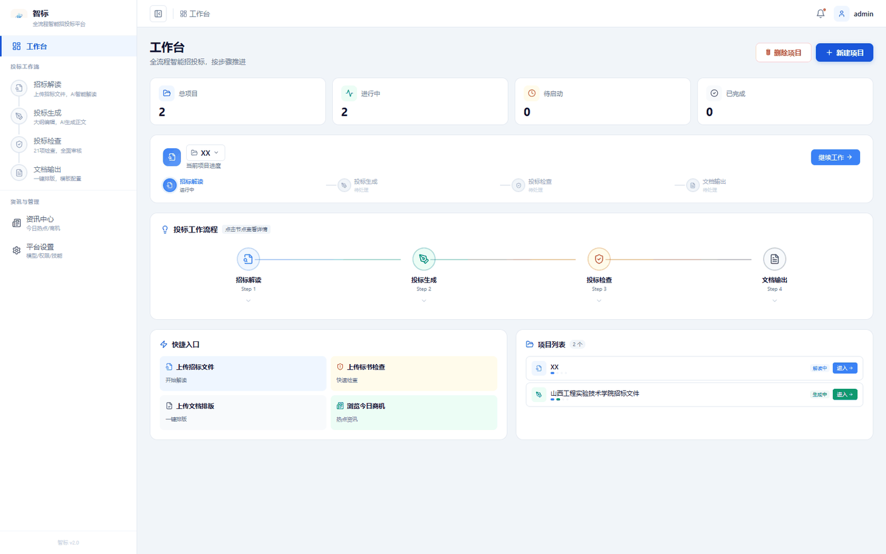 | 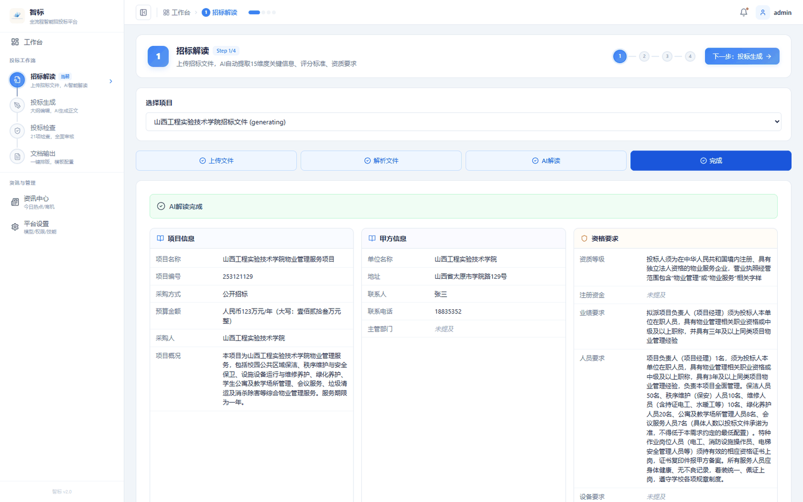 | 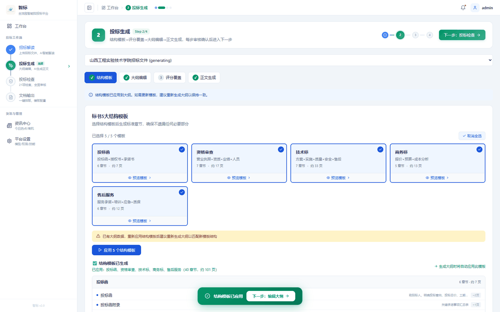 | 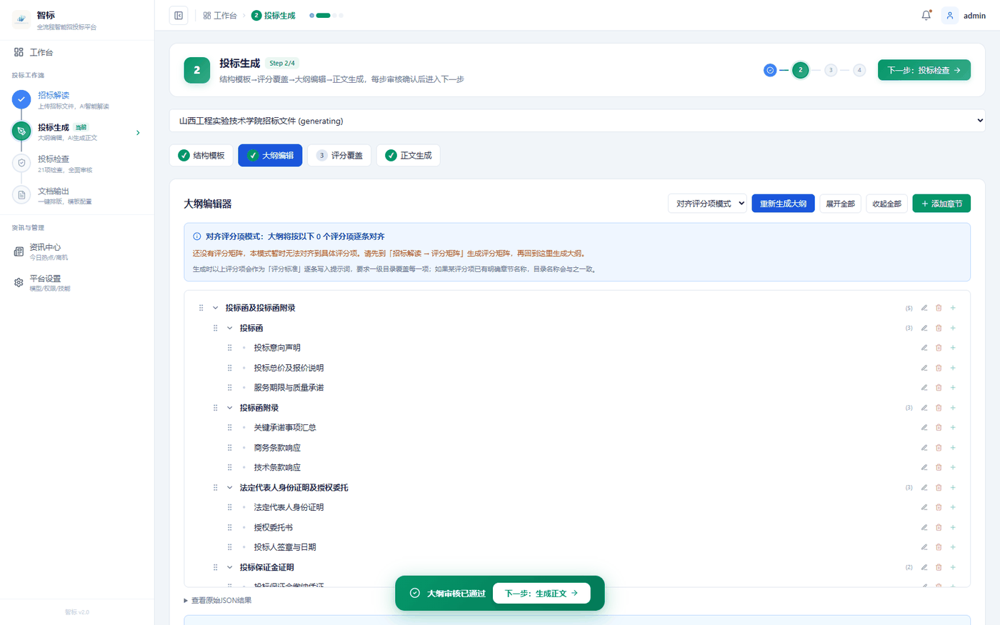 |

| 投标生成-正文 | 投标检查 | 文档输出 | 资讯中心 |
|:---:|:---:|:---:|:---:|
| 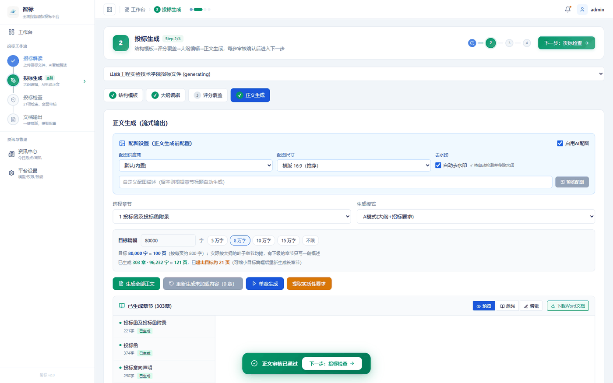 | 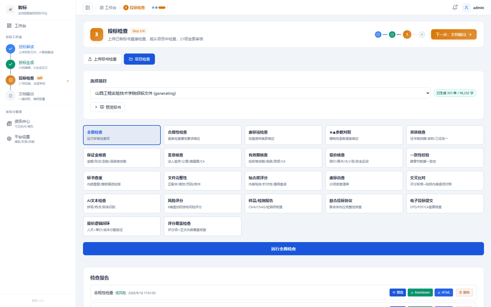 | 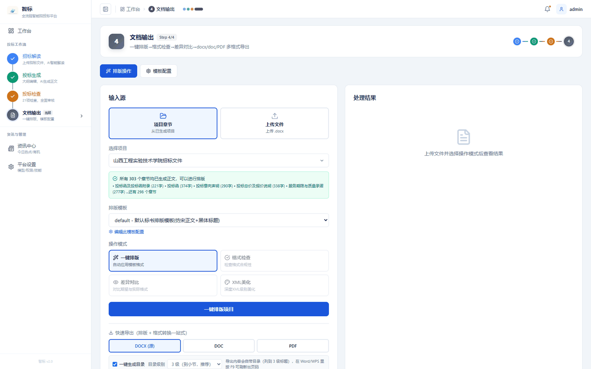 | 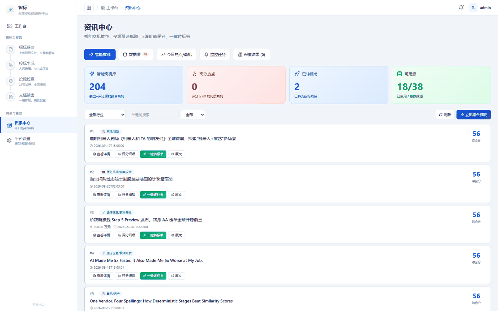 |

| 智能体模型 | LLM 供应商 | MinerU OCR | 权限管理 | Skill 管理 |
|:---:|:---:|:---:|:---:|:---:|
| 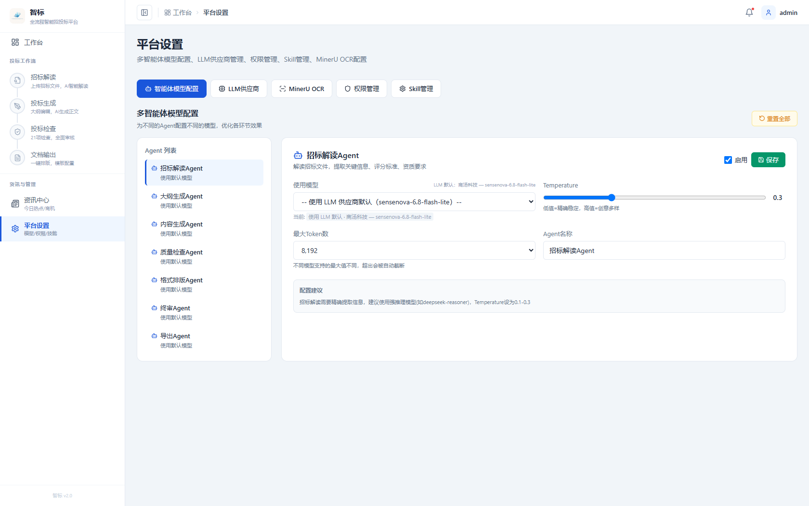 | 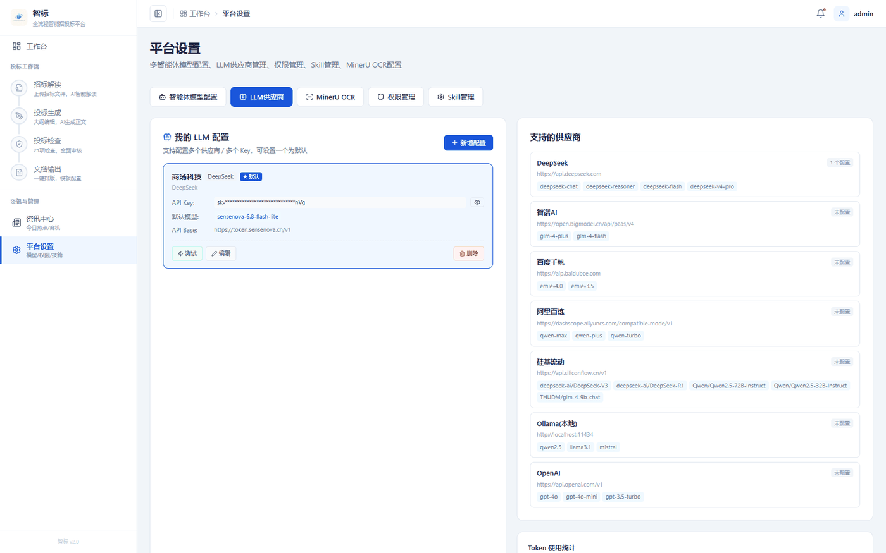 | 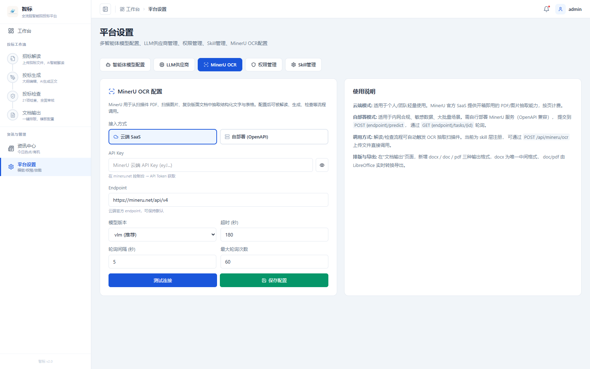 | 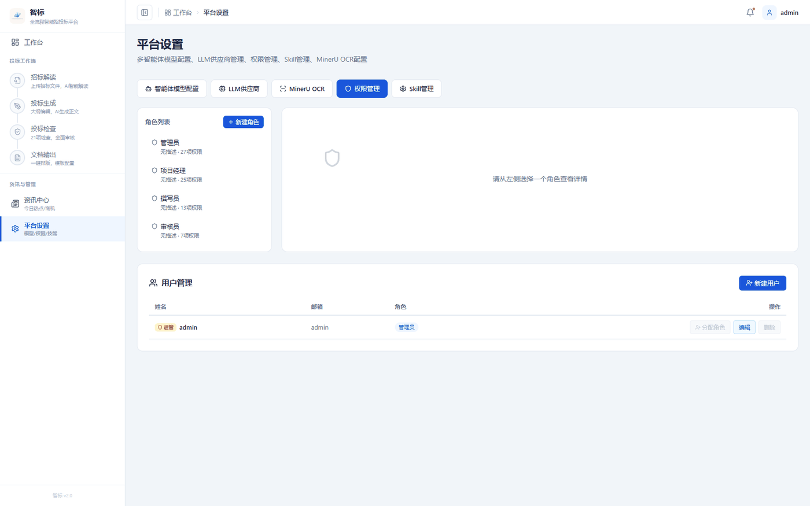 | 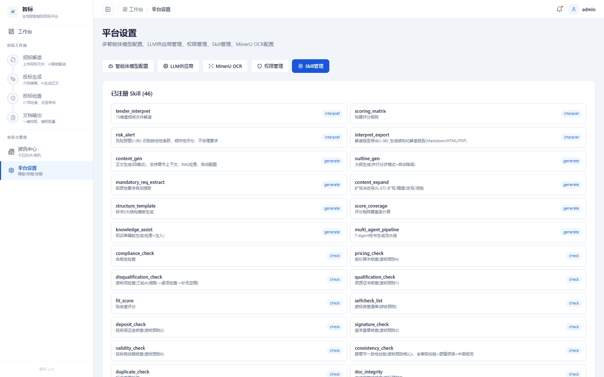 |

---

## ✨ 功能特性

- **招标解读**：PDF/DOCX/TXT 解析，自动提取评分标准 / 资质要求 / 技术参数，风险预警，评分矩阵
- **投标生成**：基于招标文件智能生成大纲 → AI 撰写各章节 → RAG 知识检索 → 并发生成有上限
- **投标检查**：21 项专业合规检查（保证金 / 签字盖章 / 有效期 / 一致性 / 重复率 / 价格合理性），AI 修复方案 + 原文定位 + 一键应用
- **文档输出**：智能排版，docx / doc / PDF 三格式导出（docx 为唯一中间格式），字体归一化
- **MinerU OCR**：扫描件 PDF / 图片结构化抽取，平台化配置（云端 / 自部署）
- **资讯中心**：招投标公告自动抓取 + 关键词过滤 + 热度分析
- **权限管理（RBAC）**：管理员 / 项目经理 / 编写员 / 审核员，菜单级 + 操作级权限
- **多 LLM 切换**：DeepSeek / 硅基流动 / OpenAI / 通义千问 / Ollama 本地模型

---

## 🏗️ 技术架构

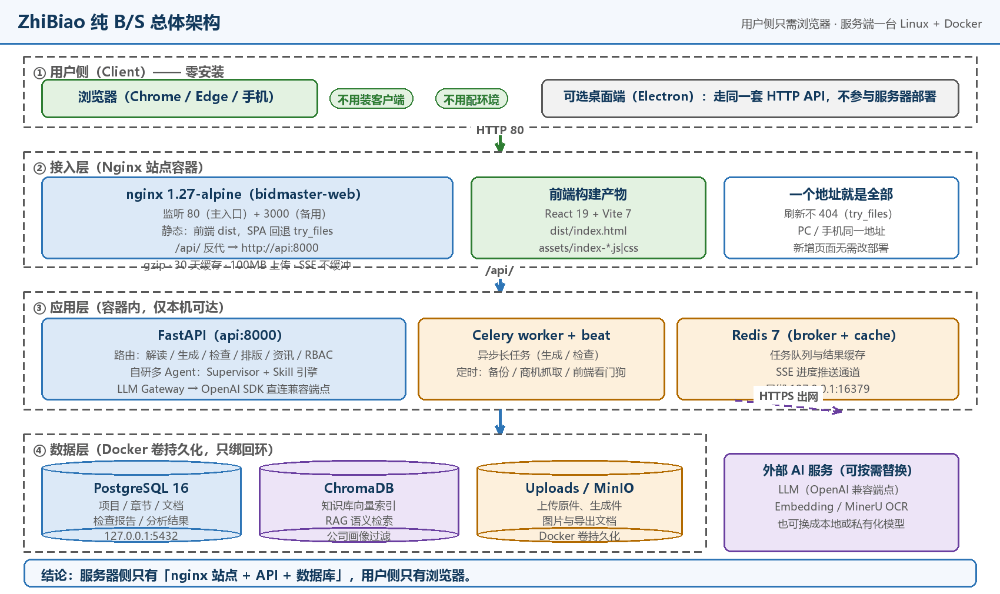

| 层 | 组成 | 对外暴露 |
| --- | --- | --- |
| 用户侧 | 浏览器（Chrome / Edge / 手机）；可选 Electron 桌面端 | — |
| 接入层 | nginx 站点：`80`（主入口）/ `3000`（备用），托管前端 dist 并反代 `/api` | **仅 80 / 3000** |
| 应用层 | FastAPI（`api:8000`）、Celery worker + beat、Redis | 仅容器内部 |
| 数据层 | PostgreSQL 16、ChromaDB 向量库、Uploads / MinIO | 仅 `127.0.0.1` |
| 外部服务 | LLM / Embedding / MinerU OCR（HTTPS 出网，可替换为本地模型） | 出网 |

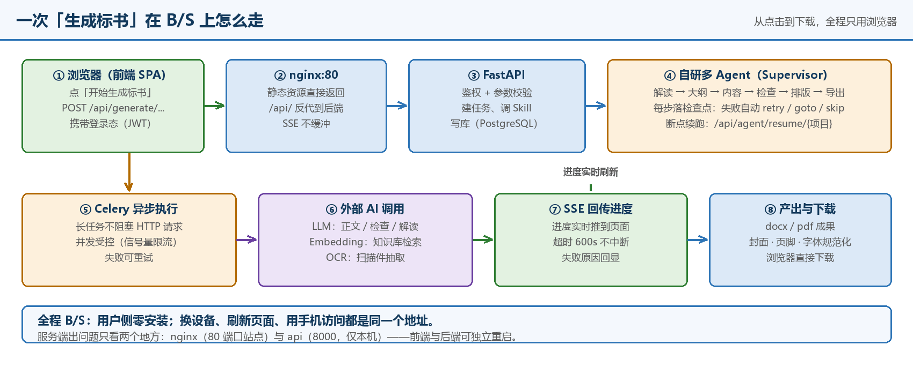

**技术栈**：FastAPI · SQLAlchemy 2.0 · asyncpg · Celery · Redis · PostgreSQL 16 · ChromaDB · MinIO · OpenAI SDK（直连兼容端点）· 自研多 Agent 框架 · LangGraph（`gate_keeper` 已接入，`orchestrator` 预留）· React 19 · Vite 7 · TypeScript 5 · TailwindCSS 4 · Electron 41 · python-docx · PyMuPDF · WeasyPrint

---

## 🚀 快速开始

### 0. 前置环境

| 组件 | ⚡ 一键脚本 | Docker 部署 | 本地开发 |
| --- | --- | --- | --- |
| 操作系统 | Windows 10/11 (PS 5.1) 或 Linux (bash) | Win / Linux / macOS | Win / Linux / macOS |
| Docker + Compose v2 | 可选（有则走 Docker） | **必需**（Win 需 WSL2） | 可选（只起 PG/Redis） |
| Python | **必需** 3.12+ | 镜像自带 | **必需** 3.12+ |
| Node.js | **必需** 18+ | 镜像自带 | **必需** 18+ |
| PostgreSQL 16+ | **必需**（本机或便携版） | 容器自带 | **必需** |
| 端口 | 8000 API / 15168 前端 / 5432 PG | 8080 站点 / 8000 / 5432 / 16379 / 19000 | 8000 / 15168 / 5432 |

> 逐步命令、目录地图、按报错查原因见 **[DEPLOY.md](DEPLOY.md)**。

### ⚡ 一键安装

**Windows**（PowerShell 5.1，自动判断 Docker / 本地）：

```powershell
cd <仓库根目录>                        # 含 pyproject.toml 的那一层
.\install.ps1                          # 自动判断
.\install.ps1 -LlmApiKey sk-xxx -Yes   # 顺带写入 Key，非交互
.\install.ps1 -Mode local -Yes         # 强制本地开发
.\stop.ps1                             # 停服务；-Docker 停容器；-WithPg 连数据库
```

**Linux**（Ubuntu/Debian/CentOS/RHEL，自动判断 Docker / 本地）：

```bash
cd <仓库根目录>
chmod +x install.sh stop.sh
./install.sh                           # 自动判断
./install.sh --llm-api-key sk-xxx --yes
./install.sh --mode docker             # 强制 Docker
./install.sh --mode local --install-deps  # 本地模式，缺什么装什么（需 sudo）
./stop.sh                              # 停服务；--docker 停容器
```

| 参数 | 默认值 | 说明 |
| --- | --- | --- |
| `-Mode` / `--mode` | `auto` | `auto` / `docker` / `local`；`auto` 下 Docker 不可用自动回落本地 |
| `-LlmApiKey` / `--llm-api-key` | 空 | 写入 `.env`（本地）或 `docker/.env.docker`（Docker） |
| `-AdminEmail` / `--admin-email` | `admin@bidmaster.pro` | 传给 `deploy/seed_admin.py` |
| `-DbName` / `--db-name` | `bidmaster` | 数据库名 |
| `-ApiPort` / `--api-port` | `8000` | API 端口 |
| `-SitePort` / `--site-port` | `8080` | Docker 站点端口 |
| `-DevPort` / `--dev-port` | `15168` | vite 开发端口 |
| `-PgRoot` / `--install-deps` | — | Windows: 便携 PG 根目录；Linux: 缺什么装什么 |
| `-SkipFrontend` / `-NoStart` | 关 | 只准备环境，不装前端 / 不起服务 |

> 依赖缺失时脚本会打印下载地址与放置位置（Python / Node.js / PostgreSQL / Docker）。全程日志在 `logs/`。

### 方式一：Docker 部署（推荐，Linux 服务器首选）

前置：Docker Engine 24+ 与 Compose v2。Windows/macOS 需先启用 WSL2（管理员 `wsl --install` 后重启）。

```bash
git clone https://github.com/Foulereee/ZhiBiao.git && cd ZhiBiao
cp .env.example .env                              # 必须存在，否则 Docker 会建同名目录
cp docker/.env.docker.example docker/.env.docker  # 在这里填 LLM_API_KEY
# 编辑 docker/.env.docker：LLM_API_KEY=...、LLM_API_BASE=...、UVICORN_WORKERS=1
# 编辑 .env：BMP_LLM_API_KEY / BMP_LLM_API_BASE（兜底）

# compose 文件在 docker/ 下，必须用 -f 指定（不要加 --project-directory .）
docker compose -f docker/docker-compose.yml --env-file docker/.env.docker --profile infra --profile web up -d --build
```

| 文件 | 变量前缀 | 谁读它 | 关键项 |
| --- | --- | --- | --- |
| `docker/.env.docker` | 无前缀 | **compose 插值** | `LLM_API_KEY`、`UVICORN_WORKERS=1`、`WEB_PORT` |
| `.env`（仓库根） | `BMP_` | 应用（pydantic），bind-mount 到 `/app/.env` | `BMP_DATABASE_URL`、`BMP_LLM_API_KEY` |

> ⚠️ 只填根 `.env` 不生效：compose 里同名变量的空默认值会覆盖容器内环境变量，LLM Key 必须在 `docker/.env.docker` 里也填。

启动后：PostgreSQL (5432) / Redis (16379→6379) / MinIO (19000) / FastAPI (8000) / Celery / nginx 站点 (8080)。

```bash
docker compose -f docker/docker-compose.yml ps           # 看状态
docker compose -f docker/docker-compose.yml logs -f api  # 看日志
docker compose -f docker/docker-compose.yml stop         # 停止（保留数据）
```

### 方式二：本地开发

```bash
python -m venv venv && source venv/bin/activate        # Windows: .\venv\Scripts\Activate.ps1
pip install -e .                                        # 后端依赖
cd packages/desktop && npm install && cd ../..          # 前端依赖
createdb -U postgres bidmaster                           # 建库
psql -U postgres -d bidmaster -f db/init_pg.sql         # 基础表 + 角色/权限（幂等）
# 其余表由 init_db() → create_all 补齐（启动 API 时自动执行，共 22 张）
uvicorn services.main:app --reload --host 0.0.0.0 --port 8000   # 后端
python deploy/seed_admin.py                             # 建管理员（系统不会自动创建）
cd packages/desktop && npm run dev                      # 前端（端口 15168，非 5173）
```

> Windows 上这 9 步 ≈ `.\install.ps1 -Mode local`，Linux 上 ≈ `./install.sh --mode local --install-deps`。

### 🔑 首次登录与校验

系统**不会自动创建管理员**，必须跑一次 `deploy/seed_admin.py`（幂等，27 权限 / 4 角色 / 1 管理员）：

```bash
python deploy/seed_admin.py                        # 本地
docker compose -f docker/docker-compose.yml exec api python deploy/seed_admin.py  # Docker
```

默认账号 `admin@bidmaster.pro`；`db/init_pg.sql` 预置初始密码 **`admin123`**，**首次登录后请立刻修改**。新账号会打印随机 16 位密码（只显示一次）；已存在的账号不会改密码。

| 检查项 | 期望结果 |
| --- | --- |
| 站点首页 | 本地 `http://127.0.0.1:15168/`；Docker `http://<主机IP>:8080/`；标题「智标」 |
| 健康检查 | `http://127.0.0.1:8000/api/health` → `{"status":"ok",…,"db_ready":true}` |
| 表结构 | `public` 下 **22 张表**（`init_pg.sql` 建 17 张，`init_db()` 补齐） |
| 角色权限 | `rbac_role_permissions` **72 行**（admin 27 / 项目经理 25 / 撰写 13 / 审核 7） |
| 鉴权 | 带 token 200；不带 token 401 |

### 🛑 停止、重启与升级

| 方式 | 停止 | 重启 / 更新 |
| --- | --- | --- |
| 一键脚本 | `.\stop.ps1` / `./stop.sh` | 再跑一次 install（幂等） |
| Docker | `… stop` | `… up -d --build`；改配置用 `… restart api` |
| Docker 彻底清理 | `… down` | ⚠️ 加 `-v` 会**删数据卷（等于删库）** |

### ✅ 实机验证记录

| 环节 | 结果 | 关键证据 |
| --- | --- | --- |
| 依赖安装 | ✅ | `pip install -e .` → 218 个包成功 |
| 数据库 | ✅ | `init_pg.sql` 0 报错 → 17 张表 / 72 行绑定 → `init_db()` 补到 22 张 |
| API | ✅ | `/api/health` 200 `db_ready:true`；`/api/stats` 200（46 个 Skill） |
| 登录鉴权 | ✅ | 64 位 token；带 token 200 / 不带 401 |
| 前端 | ✅ | `npm run build` 通过；`npm run dev` → `<title>智标</title>` |
| 一键脚本 install.ps1 | ✅ | 独立端口 + 全新库实测；幂等复跑；stop.ps1 精确停进程 |
| Docker | ⚠️ | `compose config` exit 0，但本机缺 WSL2 未能实机跑通；线上同套 compose 长期 HTTP 200 |
| 图片瘦身 | ✅ | `optimize_images.py`：17 张 PNG 4.73 MB → 1.33 MB（−72%），PSNR 39–56 dB |
| 编排进度回调 | ✅ | 生产镜像内 8/8：进度序列 `(1,3)(2,3)(3,3)`；**编排产出与改动前逐条一致**（不触碰连贯性）；子树失败仍推进进度；回调抛异常不影响编排 |
| 生成任务防重复 | ✅ | 生产镜像内 7/7：章节未推进时运行标记仍续写 7 次（旧实现为 0 次）；`finished` 后停止且不重建标记；`_read_gen_lock` 语义未变 |
| 前端源码构建 | ✅ | `tsc --noEmit` exit 0（含未使用变量检查）；`vite build` 2735 模块通过；线上 index/JS/CSS 全 200，`/api/health` 正常 |
| 界面文案删除 | ✅ | 对比线上 bundle：`' 章节'` 4→2、`'约 '` 8→6、`'页'` 22→18，与删除的 4 处一一对应；`page_target` 数据与接口保留 |

**已知边界**：① 登录会话在进程内 → `UVICORN_WORKERS` 必须为 1；② 无数据库迁移（无 `alembic.ini`），`create_all` 只建不改；③ 前端主 chunk 1.70 MB（依赖体积，未按路由拆包；logo 已从 2.39 MB 压到 64 KB，是独立产物不在 JS 内）；④ `/api/projects/` 需带尾斜杠（307）；⑤ `gate_keeper.py` 已接入，`orchestrator.py`（LangGraph）仍为预留。

---

## ⚙️ 配置说明

核心环境变量见 `.env.example`（带注释）。关键项：

| 变量 | 说明 | 默认值 |
| --- | --- | --- |
| `BMP_DATABASE_URL` | PostgreSQL 连接串 | `postgresql+asyncpg://...` |
| `BMP_LLM_API_KEY` | LLM API Key | — |
| `BMP_LLM_API_BASE` | LLM API 地址 | `https://api.deepseek.com` |
| `BMP_LLM_DEFAULT_MODEL` | 默认模型 | `deepseek/deepseek-chat` |
| `BMP_EMBEDDING_MODE` | 嵌入模式 (api/local) | `api` |
| `BMP_MINERU_MODE` | MinerU 模式 (cloud/self_hosted) | `cloud` |

LLM 支持：DeepSeek / 硅基流动 / OpenAI / 通义千问 / Ollama（本地），可在平台设置中切换。MinerU 与 Embedding 也可在平台设置页面化配置（自动写入 `.env`）。

---

## 🔧 核心概念

**Skill（技能）**：每个 Skill 是独立业务能力单元，继承 `core.skill_engine.base.Skill`，实现 `execute(ctx)` 即可。

**Agent Pipeline**：自研多 Agent 框架，模板优先（`bid_generation` 6 步 / `bid_check` 2 步），每步成功写检查点支持断点续跑；失败按 `retry / goto / skip` 策略表处理。另有 `core/agent_engine/orchestrator.py`（LangGraph DSL 动态建图）为预留引擎。

**Gate Keeper**：确保工作流按顺序执行，前一阶段未完成则不能进入下一阶段（`gate_keeper.is_passed` / `mark_passed`）。

---

## 📄 开源许可

本仓库以 **AGPL-3.0** 发布，完整条款见 [LICENSE](LICENSE)。是 [guangshu100/BidMaster-Pro](https://github.com/guangshu100/BidMaster-Pro) 的衍生作品。依据 AGPL-3.0 第 13 条，通过网络与本程序交互的用户有权获取对应源代码。第三方依赖许可见 [NOTICE.md](NOTICE.md) 第 5 节（注意 PyMuPDF 为 AGPL/商业双授权）。

## 💬 联系方式

- **GitHub**：[@Foulereee](https://github.com/Foulereee) · **邮箱**：1817558146@qq.com
- **问题反馈**：[Issue](https://github.com/Foulereee/ZhiBiao/issues) · **安全问题**：按 [SECURITY.md](SECURITY.md) 私下联系

---

<div align="center">

**Made with ❤️ by [Foulereee](https://github.com/Foulereee)**

⭐ 如果这个项目对你有帮助，请给我们一个 Star！✨

</div>
